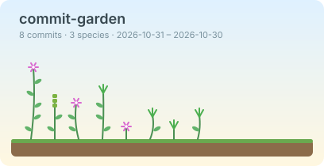

# 🌱 commit-garden

> 把你的 git commit 歷史種成一座花園。
> *Turn your git history into a garden — in your terminal or as an SVG for your README.*



每個 commit 是一株植物：**類型決定品種，改動量決定高度**，葉子怎麼長則由 commit hash 決定，所以同一個 commit 永遠長得一樣。

- 純 Python 標準函式庫，**零依賴**（只需要 Python 3.9+ 和 `git`）
- 兩種輸出：終端機 ASCII（可上色）、SVG（淺色／深色主題）
- `stats` 指令：物種分布、Shannon 物種多樣性指數、最勤勞的園丁
- `demo` 指令：沒有現成 repo 也能馬上看到效果
- 內建 GitHub Action：每次 push 自動更新 README 裡的花園

## 快速開始

```bash
git clone https://github.com/<你的帳號>/commit-garden.git
cd commit-garden

# 1. 先用示範 repo 看看長什麼樣子
python -m commit_garden demo /tmp/garden-demo
python -m commit_garden grow /tmp/garden-demo

# 2. 種你自己的 repo
python -m commit_garden grow /path/to/your/repo

# 或者安裝成指令
pip install .
commit-garden grow
```

## 指令

| 指令 | 說明 |
| --- | --- |
| `commit-garden grow [repo]` | 種出花園（不給指令時的預設動作） |
| `commit-garden stats [repo]` | 物種分布與多樣性統計 |
| `commit-garden legend` | 顯示所有植物的圖例 |
| `commit-garden demo <dir>` | 建立一個示範用的 git repo |

`grow` 常用選項：

```bash
commit-garden grow -n 100                   # 只種最近 100 個 commit（預設 48）
commit-garden grow --per-row 16             # 每一畦種 16 株
commit-garden grow --color always | less -R # 強制上色
commit-garden grow -f svg -o garden.svg     # 輸出 SVG
commit-garden grow -f svg --theme dark -o garden-dark.svg
commit-garden grow --title "我的花園"
```

## 物種對照表

| commit 類型 | 植物 | ASCII |
| --- | --- | :-: |
| `feat` | 向日葵 | `@` |
| `fix` | 蘑菇 | `m` |
| `docs` | 青草 | `w` |
| `refactor` | 藤蔓 | `&` |
| `test` | 三葉草 | `%` |
| `perf` | 松樹 | `^` |
| `style` | 蘆葦 | `~` |
| `ci` / `build` | 竹子 | `#` |
| `chore` | 石頭 | `o` |
| `revert` | 枯枝 | `x` |
| 其他 | 野花 | `*` |

優先順序：`Revert ...` → [Conventional Commits](https://www.conventionalcommits.org/) 前綴（`feat(api): ...`）→ 標題關鍵字猜測 → 野花。
所以就算你的 commit 訊息不守規矩，也一樣能種出東西。

**高度**：`1 + log2(1 + 新增行數 + 刪除行數) / 2`，上限 7。用對數是為了讓一個大 commit 不會把整張圖撐爆。

## 讓 README 自動長出你的花園

`.github/workflows/garden.yml` 會在每次 push 到 `main`、每週一、或手動觸發時重新種一次，並更新 `assets/garden.svg`。
第一次推上 GitHub 之後，上面那張示範圖就會被你自己 repo 的花園取代。

> 如果 Action 推送失敗：到 repo 的 **Settings → Actions → General → Workflow permissions**，選擇 *Read and write permissions*。

## 專案結構

```
commit-garden/
├── commit_garden/
│   ├── cli.py            # 命令列介面（argparse）
│   ├── gitlog.py         # 呼叫 git log 並解析成 Commit
│   ├── species.py        # 物種定義與 commit 分類
│   ├── garden.py         # Commit -> Plant（品種、高度、種子）
│   ├── render_ascii.py   # 終端機渲染
│   ├── render_svg.py     # SVG 渲染
│   ├── stats.py          # 統計與多樣性指數
│   └── demo.py           # 產生示範 repo
├── tests/                # unittest，共 32 個測試
├── assets/garden.svg     # README 上的花園
└── .github/workflows/    # CI 與自動更新花園
```

## 開發

```bash
make test    # 或：python -m unittest discover -s tests -v
make demo    # 建立示範 repo 並印出花園
make svg     # 重新產生 assets/garden.svg
```

## 之後可以做的事

- [ ] `--since` / `--author` 篩選
- [ ] 季節與天氣：依 commit 時間讓花園變春夏秋冬
- [ ] 多個 repo 合併成一座大花園
- [ ] 動畫 SVG：植物隨時間一株一株長出來
- [ ] 用 GitHub API 種出整個帳號的森林

歡迎開 issue 或 PR 增加新的植物 🌿

## 授權

MIT
